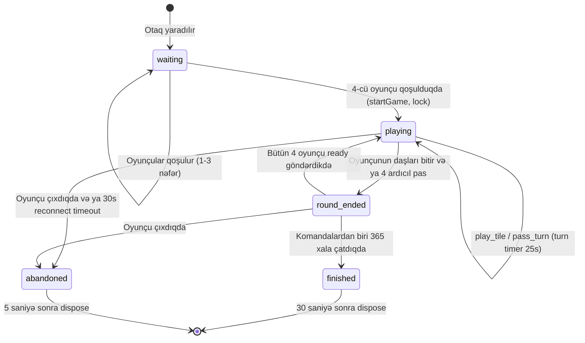

# Çayxana — Domino 365 Flutter Client API Müqaviləsi (API Contract)

Bu sənəd **Çayxana Domino 365** multiplayer backend-i (`Domino365Room`) ilə **Flutter** müştəri tətbiqi arasındakı rəsmi əlaqə və rabitə müqaviləsidir.

Sənəd birbaşa serverin mövcud mənbə kodları əsasında yoxlanılmış və hazırlanmışdır:
- `src/rooms/Domino365Room.ts` (Colyseus Room handler)
- `src/rooms/schema/Domino365RoomState.ts` (Colyseus Schema)
- `src/games/domino/domino365/Domino365Game.ts` (Oyun qaydaları və vəziyyət idarəetməsi)
- `src/games/domino/domino365/Domino365RoundManager.ts` (Raund hesablama qaydaları)
- `src/app.config.ts` (Otaq qeydiyyatı və matchmaking)

---

## 1. Server Bağlantısı və Matchmaking

### 1.1 Əsas Məlumatlar
- **Protokol:** WebSocket (`ws://` lokal development, `wss://` production)
- **Host / Port:** `ws://<SERVER_IP>:2568` (development üçün susmaya görə port 2568-dir)
- **Room adı:** `domino365`
- **Backend Colyseus Versiyası:** `0.18.2`

### 1.2 Matchmaking Davranışı
Backend `app.config.ts` faylında otağın qeydiyyatı:
```typescript
domino365: defineRoom(Domino365Room).sortBy({ clients: -1 })
```
- **Otağın maksimum tutumu:** 4 oyunçu (`maxClients = 4`).
- **Matchmaking məntiqi:** `.sortBy({ clients: -1 })` metodu ilə müştəri `joinOrCreate("domino365", options)` etdikdə server ilk növbədə ən çox oyunçusu olan (1-3 oyunçulu) otağı seçir və 4 nəfərə tamamlayır. Uyğun otaq yoxdursa, yeni otaq yaradılır.
- **Kilidlənmə:** 4-cü oyunçu daxil olan kimi server dərhal `this.lock()` çağırır (`Domino365Room.ts:402`) və otaq yeni qoşulmalara bağlanır.

### 1.3 Qoşulma Parametrləri (Join Options)
Flutter tərəfindən otağa qoşularkən göndərilən obyekt:
```json
{
  "name": "Oyunçu Adı"
}
```
- `name` *(string, könüllü)*: Oyunçunun adı (boş olarsa və ya göndərilməzsə, server `Player 1`, `Player 2` kimi avtomatik ad təyin edir; server ən çox 20 simvol qəbul edir: `name.trim().slice(0, 20)`).

---

## 2. Otaq Vəziyyəti (Room State: `Domino365RoomState`)

Colyseus State serverdən bütün oyunçulara avtomatik sinxronlaşdırılır (state sync).

### 2.1 State Sahələri

| Sahə | Tip | İlkin Dəyər | İzah |
|---|---|---|---|
| `status` | `string` | `"waiting"` | Otağın cari vəziyyəti: `"waiting"`, `"playing"`, `"round_ended"`, `"finished"`, `"abandoned"` |
| `players` | `Array<Domino365RoomPlayer>` | `[]` | Otaqdakı oyunçuların siyahısı (maksimum 4 nəfər) |
| `boardTiles` | `Array<Domino365PublicTile>` | `[]` | Masaya qoyulmuş bütün daşların siyahısı |
| `openEnds` | `Array<Domino365PublicOpenEnd>` | `[]` | Daş qoşula biləcək açıq ucların siyahısı |
| `scoreA` | `number` | `0` | A Komandasının ümumi xalı |
| `scoreB` | `number` | `0` | B Komandasının ümumi xalı |
| `currentPlayerId` | `string` | `""` | Cari növbəsi olan oyunçunun `sessionId`-si (yalnız `playing` statusunda aktiv olur) |
| `roundNumber` | `number` | `1` | Cari raundun nömrəsi (1-dən başlayır) |
| `consecutivePasses` | `number` | `0` | Ardıcıl edilmiş pasların sayı (4-ə çatarsa, raund bloklanır) |
| `endgameMode` | `boolean` | `false` | Komandalardan hər hansı biri 300 xala çatdıqda `true` olur (əl sonu bonus xallarını ləğv edir) |
| `spinnerActive` | `boolean` | `false` | Masada spinner daşının 4 qolunun da açıq olub-olmadığını bildirir |
| `spinnerTileId` | `string` | `""` | Spinner olan cüt daşın ID-si |
| `spinnerValue` | `number` | `-1` | Spinner daşının xalı (məs: 5-5 üçün 5) |
| `winnerTeamId` | `string` | `""` | Oyun bitdikdə qalib komanda (`"A"` və ya `"B"`) |
| `turnExpiresAt` | `number` | `0` | Növbə timer-inin bitəcəyi vaxt (Unix timestamp millisaniyə ilə: `Date.now() + durationMs`). Növbə timer-i yoxdursa `0` olur. |

---

### 2.2 Alt Sxemlər (Nested Schemas)

#### `Domino365RoomPlayer`
| Sahə | Tip | İzah |
|---|---|---|
| `sessionId` | `string` | Oyunçunun unikal Colyseus client `sessionId`-si |
| `name` | `string` | Oyunçunun görünən adı (maksimum 20 simvol) |
| `teamId` | `string` | Oyunçunun komandası: `"A"` (oturacaq 0 və 2) və ya `"B"` (oturacaq 1 və 3) |
| `ready` | `boolean` | Raund bitdikdən sonra növbəti raunda hazır olub-olmaması |
| `connected` | `boolean` | Oyunçunun internet bağlantısının aktiv olub-olmaması (`false` = disconnect olub) |
| `handCount` | `number` | Oyunçunun əlində qalan daşların sayı (digər oyunçular yalnız sayı görür) |

#### `Domino365PublicTile`
| Sahə | Tip | İzah |
|---|---|---|
| `id` | `string` | Daşın unikal ID-si (məs: `"0-5"`, `"5-5"`) |
| `left` | `number` | Daşın sol tərəfinin xalı (0-6) |
| `right` | `number` | Daşın sağ tərəfinin xalı (0-6) |
| `connectedEndId` | `string` | Bu daşın qoşulduğu ucun ID-si (ilk daş üçün boş `""`) |
| `matchedValue` | `number` | Qoşulan tərəfin dəyəri |
| `freeValue` | `number` | Boş qalan açıq tərəfin dəyəri |

#### `Domino365PublicOpenEnd`
| Sahə | Tip | İzah |
|---|---|---|
| `id` | `string` | Ucun unikal ID-si (Flutter gediş edərkən bu ID-ni göndərir) |
| `value` | `number` | Bu uca qoyula biləcək rəqəm (0-6) |
| `sourceTileId` | `string` | Bu ucu yaradan daşın ID-si |
| `countsForSpinnerActivation` | `boolean` | Spinner aktivləşməsi üçün sayılıb-sayılmaması |

---

## 3. Şəxsi Oyunçu Məlumatları (Private Hand vs Public State)

Domino oyununda hər kəsin öz daşı məxfi saxlanmalıdır:
1. **Public State:** `players[i].handCount` yalnız rəqəm bildirir (neçə daşı qalıb). Heç bir rəqib digərinin daşlarını State vasitəsilə oxuya bilməz.
2. **Private Hand Event:** Hər bir oyunçuya öz daşları birbaşa şəxsi mesaj (`client.send("your_hand", ...)`) vasitəsilə göndərilir:
   - Oyun başlayanda (`startGame` — `Domino365Room.ts:412`)
   - Oyunçu gediş etdikdə (`play_tile` — `Domino365Room.ts:91` və ya timeout auto-play — `Domino365Room.ts:698`)
   - Oyunçu əlini təkrar istədikdə (`get_hand` — `Domino365Room.ts:54-56`)
   - Oyunçu təkrar qoşulduqda (`onReconnect` — `Domino365Room.ts:340`)
   - Yeni raund başladıqda (`round_started` — `Domino365Room.ts:203`)

---

## 4. Müştəridən Serverə Göndərilən Mesajlar (Client-to-Server)

Flutter tətbiqi bu mesajları `room.send(type, payload)` vasitəsilə göndərir.
Backend kodunda cəmi **5 ədəd** `this.onMessage` handler-i mövcuddur:

### 4.1 `set_name` (`Domino365Room.ts:33-51`)
Oyunçu adını təyin edir və ya dəyişir (yalnız `waiting` statusunda qəbul edilir).
- **Format:**
  ```json
  {
    "name": "Rustam"
  }
  ```
- **Qaydalar:** `name` string olmalıdır, `trim()` edilir və maksimum 20 simvola kəsilir.

### 4.2 `get_hand` (`Domino365Room.ts:54-56`)
Oyunçunun öz əlindəki daşları serverdən yenidən istəməsi üçün handler.
- **Kod:**
  ```typescript
  // Domino365Room.ts:54-56
  this.onMessage("get_hand", (client: Client) => {
    this.sendPrivateHand(client);
  });
  ```
- **Format:**
  ```json
  {}
  ```
- **Cavab:** Server həmin oyunçuya dərhal `your_hand` hadisəsini göndərir.

### 4.3 `play_tile` (`Domino365Room.ts:59-112`)
Masanın müəyyən ucuna daş qoymaq üçün istifadə edilir.
- **Format:**
  ```json
  {
    "tileId": "5-5",
    "endId": "end-1"
  }
  ```
- **Qaydalar:**
  - `tileId` *(string, məcburi)*: Oynanacaq daşın ID-si.
  - `endId` *(string, könüllü)*: Qoşulacaq ucun ID-si. Əgər masa boşdursa (ilk gediş), `endId` göndərilmir (`undefined`).
  - Əgər növbə həmin oyunçuda deyilsə, daş oyunçunun əlində yoxdursa və ya həmin uca uyğun gəlmirsə, server `game_error` göndərəcək.

### 4.4 `pass_turn` (`Domino365Room.ts:115-143`)
Növbəni növbəti oyunçuya ötürmək üçün (pas vermək).
- **Format:**
  ```json
  {}
  ```
- **Qaydalar:** Oyunçunun əlində masaya qoyula biləcək ən azı 1 ədəd daş varsa, server pas verməyə icazə vermir və `game_error` qaytarır: `"Player has a playable tile and cannot pass"`.

### 4.5 `ready` (`Domino365Room.ts:146-223`)
Raund başa çatdıqdan sonra növbəti raunda başlamağa hazır olduğunu bildirir.
- **Format:**
  ```json
  {}
  ```
- **Qaydalar:**
  - Yalnız `state.status === "round_ended"` olduqda qəbul edilir.
  - Oyun `finished` olubsa və ya raund hələ davam edirsə, xəta atır.
  - 4 oyunçunun hamısı `ready` göndərdikdə avtomatik yeni raund başlayır.

---

## 5. Serverdən Müştəriyə Göndərilən Hadisələr (Server-to-Client Events)

Flutter tətbiqi bu hadisələri `room.onMessage(type, (data) { ... })` vasitəsilə dinləyir.
Backend kodunda cəmi **15 ədəd** hadisə mövcuddur (2 unicast + 13 broadcast):

### 5.1 Şəxsi Hadisələr (Direct / Unicast — `client.send`)

#### `your_hand` (`Domino365Room.ts:442-448`)
Yalnız sorğu edən və ya əli yenilənən oyunçuya çatır.
```json
{
  "tiles": [
    { "id": "0-0", "left": 0, "right": 0 },
    { "id": "0-5", "left": 0, "right": 5 },
    { "id": "5-5", "left": 5, "right": 5 }
  ]
}
```

#### `game_error` (`Domino365Room.ts:585`)
Oyunçunun səhv və ya qayda pozuntusu əməliyyatına cavab olaraq yalnız həmin oyunçuya göndərilir.
```json
{
  "message": "It is not this player's turn"
}
```

---

### 5.2 Ümumi Hadisələr (Broadcast — `this.broadcast`)

#### `player_joined` (`Domino365Room.ts:265-270`)
Yeni oyunçu otağa daxil olduqda yayımlanır.
```json
{
  "playerId": "client_session_id_123",
  "name": "Player 1",
  "teamId": "A",
  "playerCount": 1
}
```

#### `player_left` (`Domino365Room.ts:376-379`)
Yalnız `waiting` statusunda oyunçu otaqdan çıxarsa yayımlanır.
```json
{
  "playerId": "client_session_id_123",
  "playerCount": 2
}
```

#### `waiting_room_updated` (`Domino365Room.ts:381-389`)
`waiting` statusunda oyunçu çıxdıqda və komandalar yenidən balanslaşdırıldıqda yayımlanır.
```json
{
  "players": [
    { "sessionId": "id_1", "name": "Player 1", "teamId": "A", "seatIndex": 0 },
    { "sessionId": "id_2", "name": "Player 2", "teamId": "B", "seatIndex": 1 }
  ],
  "playerCount": 2
}
```

#### `game_started` (`Domino365Room.ts:424-428`)
4 oyunçu tamamlandıqda və ilk raund başladıqda yayımlanır.
```json
{
  "roundNumber": 1,
  "currentPlayerId": "client_session_id_123"
}
```

#### `move_played` (`Domino365Room.ts:93-99`, avtomatik gediş üçün `Domino365Room.ts:701-709`)
Hər hansı oyunçu daş oynadıqda (özü və ya timeout ilə auto-play) yayımlanır.
```json
{
  "playerId": "client_session_id_123",
  "tileId": "0-5",
  "points": 5,
  "currentPlayerId": "next_player_session_id",
  "status": "playing",
  "autoPlayed": true
}
```
*(Qeyd: `autoPlayed` sahəsi yalnız növbə vaxtı bitdikdə və server daşı avtomatik oynadıqda `true` olaraq əlavə edilir).*

#### `turn_passed` (`Domino365Room.ts:126-132`, avtomatik pas üçün `Domino365Room.ts:723-730`)
Oyunçu pas verdikdə (özü və ya timeout ilə auto-pass) yayımlanır.
```json
{
  "playerId": "client_session_id_123",
  "currentPlayerId": "next_player_session_id",
  "consecutivePasses": 1,
  "status": "playing",
  "autoPassed": true
}
```
*(Qeyd: `autoPassed` sahəsi yalnız növbə vaxtı bitdikdə və server avtomatik pas verdikdə `true` olaraq əlavə edilir).*

#### `player_ready` (`Domino365Room.ts:179-183`)
Raund bitdikdən sonra bir oyunçu `ready` göndərdikdə yayımlanır.
```json
{
  "playerId": "client_session_id_123",
  "readyCount": 3,
  "totalPlayers": 4
}
```

#### `round_started` (`Domino365Room.ts:205-212`)
Bütün 4 oyunçu hazır olduqdan sonra yeni raund başlayarkən yayımlanır.
```json
{
  "roundNumber": 2,
  "currentPlayerId": "client_session_id_456",
  "scoreA": 45,
  "scoreB": 60,
  "endgameMode": false
}
```

#### `round_ended` (`Domino365Room.ts:558-568`)
Raund hər hansı səbəbdən bitdikdə (daşlar qurtardıqda və ya bloklandıqda) yayımlanır.
```json
{
  "roundNumber": 1,
  "scores": { "A": 50, "B": 25 },
  "bonusPoints": { "A": 15, "B": 0 },
  "remainingPips": { "A": 0, "B": 14 },
  "bonusReason": "player_finished",
  "endgameMode": false,
  "sessionEnded": false,
  "sessionWinnerTeamId": null,
  "bothTeamsReachedTarget": false
}
```
- `bonusReason` mümkün dəyərləri (`Domino365RoundManager.ts:57-61`):
  - `"player_finished"`: Oyunçulardan biri bütün daşlarını bitirdi.
  - `"blocked"`: Oyun bloklandı (4 pas), daha az xalı qalan komanda bonus qazandı.
  - `"blocked_tie"`: Oyun bloklandı və hər iki komandanın qalan daş xalı bərabər oldu (bonus verilmir).
  - `"endgame_no_bonus"`: Oyun 300+ rejimindədir (əl sonu heç kimə əl xalı bonusu verilmir).

#### `game_finished` (`Domino365Room.ts:571-575`)
Komandalardan biri 365 xala çatdıqda və oyun yekunlaşdıqda yayımlanır.
```json
{
  "winnerTeamId": "A",
  "bothTeamsReachedTarget": false,
  "scores": { "A": 370, "B": 290 }
}
```
*(Bu hadisədən 30 saniyə sonra otaq server tərəfindən təmizlənir).*

#### `player_disconnected` (`Domino365Room.ts:300-304`)
Oyunçunun internet bağlantısı kəsildikdə yayımlanır.
```json
{
  "playerId": "client_session_id_123",
  "playerName": "Rustam",
  "reconnectTimeout": 30
}
```

#### `player_reconnected` (`Domino365Room.ts:350-353`)
Oyunçu 30 saniyə ərzində yenidən qoşulduqda yayımlanır.
```json
{
  "playerId": "client_session_id_123",
  "playerName": "Rustam"
}
```

#### `game_abandoned` (`Domino365Room.ts:648-651`)
Oyunçu oyunu tərk etdikdə və ya 30 saniyəlik reconnect vaxtı bitdikdə yayımlanır.
```json
{
  "playerId": "client_session_id_123",
  "message": "A player left the game."
}
```
*(Bu hadisədən 5 saniyə sonra otaq bağlanır).*

---

## 6. Oyun Vəziyyətlərinin Həyat Dövrü (State Lifecycle)



---

## 7. İnternet Qırılması və Reconnection (Disconnect / Reconnect)

1. **İnternet kəsildikdə (`onDrop`):**
   - Server oyunçunun `connected` dəyərini `false` edir.
   - Əgər növbə həmin oyunçudadırsa, 25 saniyəlik növbə timer-i dayandırılır (pause) və qalan saniyələr yadda saxlanılır.
   - `player_disconnected` hadisəsi 30 saniyəlik reconnect bildirişi ilə yayılır.
2. **Oyunçu qayıtdıqda (30 saniyə ərzində):**
   - Flutter SDK `reconnectionToken` vasitəsilə təkrar qoşulur.
   - Serverdə `onReconnect` işə düşür: `player.connected = true` olur.
   - Server dərhal oyunçuya `your_hand` göndərir.
   - Əgər növbə onun idisə, dayandırılmış timer qalan vaxtdan davam etdirilir.
   - Digər oyunçulara `player_reconnected` yayılır.
3. **Oyunçu qayıtmadıqda (30 saniyə bitdikdə):**
   - Server oyunu `abandoned` statusuna keçirir.
   - Hamıya `game_abandoned` bildirilir.
   - 5 saniyədən sonra otaq serverdən silinir.

---

## 8. Server Xətaları (Error Messages)

Server `game_error` hadisəsi vasitəsilə aşağıdakı standart ingiliscə xəta mətnlərini qaytarır:

| Xəta Mətni | Səbəb | Mənbə Sətri |
|---|---|---|
| `"It is not this player's turn"` | Başqasının növbəsində daş oynamağa və ya pas verməyə cəhd edilib | `Domino365Game.ts:222`, `Domino365Game.ts:298` |
| `"Player has a playable tile and cannot pass"` | Əlində qoyula biləcək daş olduğu halda pas verməyə cəhd edilib | `Domino365Game.ts:307` |
| `"Invalid tile ID"` | Göndərilən daş ID-si string deyil və ya formatı düzgün deyil | `Domino365Room.ts:69` |
| `"Invalid end ID"` | Göndərilən uc ID-si mövcud deyil və ya formatı düzgün deyil | `Domino365Room.ts:76` |
| `"Tile does not belong to this player"` | Oyunçunun öz əlində olmayan daşı oynamağa cəhd edilib | `Domino365Game.ts:230` |
| `"Invalid tile placement"` | Seçilmiş daş seçilmiş ucun rəqəminə uyğun gəlmir | `Domino365Game.ts:234` |
| `"Game is not currently playing"` | Oyun hələ başlamayıb və ya artıq dayandırılıb | `Domino365Game.ts:184` |
| `"Player is not in this room"` | Otaqda qeydiyyatda olmayan `sessionId` ilə əməliyyat edilib | `Domino365Room.ts:156` |
| `"Game has already finished"` | Oyun artıq bitib, yeni əməliyyat edilə bilməz | `Domino365Room.ts:161` |
| `"Cannot ready up before round ends"` | Raund davam edərkən `ready` göndərilib | `Domino365Room.ts:166` |
| `"Game has already started"` | Başlamış otağa yeni oyunçu daxil olmağa cəhd edib | `Domino365Room.ts:237` |
| `"Room is full"` | 4 nəfərlik dolu otağa daxil olmağa cəhd edib | `Domino365Room.ts:243` |

---

## 9. Flutter / Dart Nümunə Kodu

Flutter tərəfində rəsmi `colyseus` paketi vasitəsilə qoşulma nümunəsi:

> [!NOTE]
> Colyseus Dart SDK-da reconnect metodu paketin versiyasından asılı olaraq:
> - `colyseus >= 0.15.0`: `client.reconnect(reconnectionToken)`
> - `colyseus <= 0.14.x`: `client.reconnect(roomId, reconnectionToken)`

```dart
import 'package:colyseus/colyseus.dart';

class Domino365Service {
  Client? _client;
  Room? _room;
  String? _reconnectionToken;
  String? _roomId;

  List<Map<String, dynamic>> myHand = [];

  Future<void> connect({required String serverUrl, required String playerName}) async {
    _client = Client(serverUrl);

    try {
      // 1. Otağa qoşulma və ya yeni otaq yaratma
      _room = await _client!.joinOrCreate("domino365", {
        "name": playerName,
      });

      _roomId = _room!.id;
      // Reconnect üçün tokeni saxla
      _reconnectionToken = _room!.reconnectionToken;

      print("Domino365 Otağına qoşuldu: ${_room!.id}, Session: ${_room!.sessionId}");

      _setupListeners();
    } catch (e) {
      print("Qoşulma xətası: $e");
    }
  }

  void _setupListeners() {
    if (_room == null) return;

    // Şəxsi əl məlumatını dinlə (get_hand cavabı və ya avtomatik yenilənmə)
    _room!.onMessage("your_hand", (data) {
      print("Mənim daşlarım gəldi: ${data['tiles']}");
      myHand = List<Map<String, dynamic>>.from(data['tiles']);
    });

    // Xətaları dinlə
    _room!.onMessage("game_error", (data) {
      print("Oyun xətası: ${data['message']}");
    });

    // Oyun hadisələri
    _room!.onMessage("game_started", (data) {
      print("Oyun başladı! Raund: ${data['roundNumber']}, Növbə: ${data['currentPlayerId']}");
    });

    _room!.onMessage("move_played", (data) {
      print("Daş oynandı: ${data['playerId']} oynadı ${data['tileId']}, Qazanılan xal: ${data['points']}");
    });

    _room!.onMessage("turn_passed", (data) {
      print("Pas verildi: ${data['playerId']}, Növbəti oyunçu: ${data['currentPlayerId']}");
    });

    _room!.onMessage("round_ended", (data) {
      print("Raund bitdi! Xallar: ${data['scores']}, Qalib komanda: ${data['sessionWinnerTeamId']}");
    });

    _room!.onMessage("game_finished", (data) {
      print("Oyun yekunlaşdı! Qalib: ${data['winnerTeamId']}");
    });

    _room!.onMessage("player_disconnected", (data) {
      print("Oyunçu ayrıldı: ${data['playerName']}, 30 saniyə gözlənilir...");
    });

    _room!.onMessage("player_reconnected", (data) {
      print("Oyunçu qayıtdı: ${data['playerName']}");
    });

    _room!.onMessage("game_abandoned", (data) {
      print("Oyun tərk edildi: ${data['message']}");
    });

    // State dəyişikliklərini dinlə
    _room!.onStateChange.listen((state) {
      // state.status, state.scoreA, state.scoreB, state.boardTiles və s.
    });
  }

  // Daş oynamaq
  void playTile(String tileId, {String? endId}) {
    _room?.send("play_tile", {
      "tileId": tileId,
      if (endId != null) "endId": endId,
    });
  }

  // Pas vermək
  void passTurn() {
    _room?.send("pass_turn", {});
  }

  // Yeni raunda Ready göndərmək
  void sendReady() {
    _room?.send("ready", {});
  }

  // Əl daşlarını yenidən serverdən istəmək
  void requestHand() {
    _room?.send("get_hand", {});
  }

  // Təkrar qoşulma (reconnect)
  Future<void> reconnect() async {
    if (_client != null && _reconnectionToken != null) {
      try {
        // SDK versiyasına görə reconnect çağırışı
        _room = await _client!.reconnect(_reconnectionToken!);
        _setupListeners();
        print("Uğurla təkrar qoşuldu!");
      } catch (e) {
        print("Təkrar qoşulma uğursuz oldu: $e");
      }
    }
  }

  void leave() {
    _room?.leave();
  }
}
```

---

## 10. Audit və Yoxlama Xülasəsi

| Kateqoriya | Sənəddəki Say | Real Kodda Say | Uyğunluq |
|---|---|---|---|
| **Client Messages** | 5 | 5 (`set_name`, `get_hand`, `play_tile`, `pass_turn`, `ready`) | ✅ 100% təsdiqləndi |
| **Server Direct Events** | 2 | 2 (`your_hand`, `game_error`) | ✅ 100% təsdiqləndi |
| **Server Broadcast Events** | 13 | 13 (`player_joined`, `player_left`, `waiting_room_updated`, `game_started`, `move_played`, `turn_passed`, `player_ready`, `round_started`, `round_ended`, `game_finished`, `player_disconnected`, `player_reconnected`, `game_abandoned`) | ✅ 100% təsdiqləndi |
| **State Fields** | 15 | 15 (`status`, `players`, `boardTiles`, `openEnds`, `scoreA`, `scoreB`, `currentPlayerId`, `roundNumber`, `consecutivePasses`, `endgameMode`, `spinnerActive`, `spinnerTileId`, `spinnerValue`, `winnerTeamId`, `turnExpiresAt`) | ✅ 100% təsdiqləndi |
| **Backend Testləri** | 78 test | 78 test keçir | ✅ 100% keçir |
